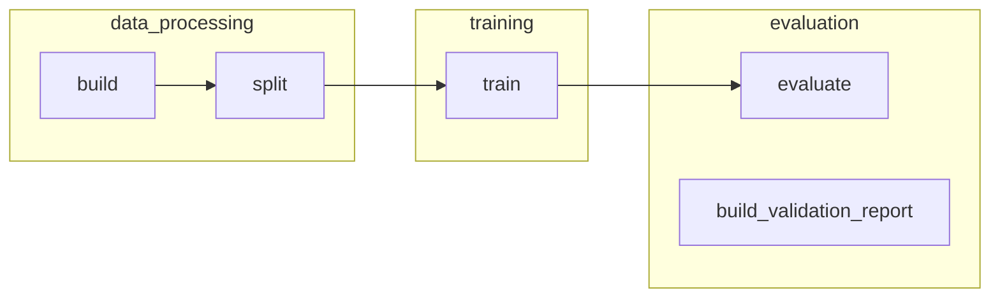

# Deep Learning Project

Пайплайны для сравнения архитектур Mamba и Transformer для задачи LM на датасете WikiText103

## Установка

```bash
bash scripts/setup.sh         # один раз после клонирования
```

```bash
uv run kedro run                            # полный сквозной (__default__)
uv run kedro run --pipeline=data_processing # отдельный пайплайн
uv run kedro registry list                  # список пайплайнов
uv run kedro viz                            # граф пайплайнов (если установлен kedro-viz)
```

## Пайплайны

| Пайплайн | Что делает | Команда |
| --- | --- | --- |
| `data_processing` | build → split | `kedro run --pipeline=data_processing` |
| `training` | dataset_split → train_artifact | `kedro run --pipeline=training` |
| `evaluation` | метрики + HTML-отчёт | `kedro run --pipeline=evaluation` |
| `full` / `__default__` | build → split → train → evaluate | `kedro run` |

### Граф пайплайнов

`__default__` - полный проход по графу  



## Запуск разных экспериментов

Параметры всех стадий лежат в `conf/base/*.yml` и подгружаются
Kedro автоматически. Чтобы поставить эксперимент - нужно только определить,
**что меняешь**, **в каком файле** этот ключ живёт, и подать оверрайд одним
из двух способов (inline через `--params` или своим env-оверлеем).

### Карта параметров: где что лежит

| Файл (`conf/base/`) | Что внутри | 
| --- | --- |
| `sources.yml` | источники данных |
| `training.yml` | общие параметры обучения |


### Свой эксперимент

Параметры env'а мёржатся **soft** поверх `conf/base`. Клади в свой env только
изменяемые ключи — всё непереопределённое наследуется из base.

```bash
# 2. Запуск под уникальным именем — оно идет в runs/train/<name>/.
RUN_NAME=my_exp_v1 uv run kedro run --env my_exp

```